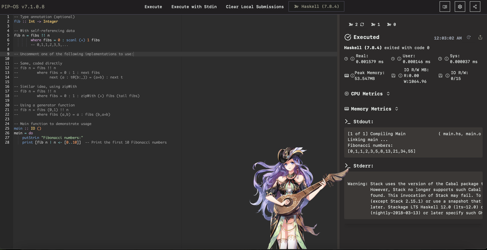
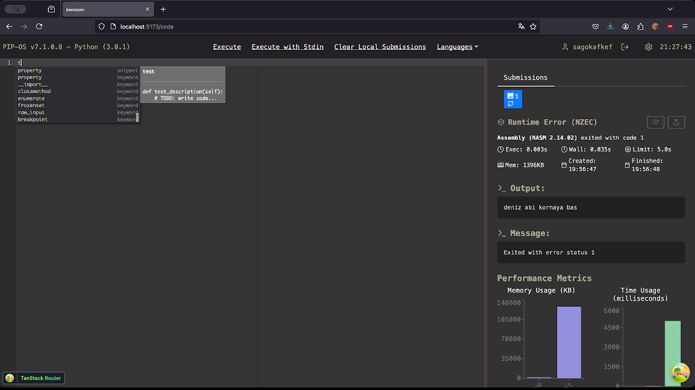
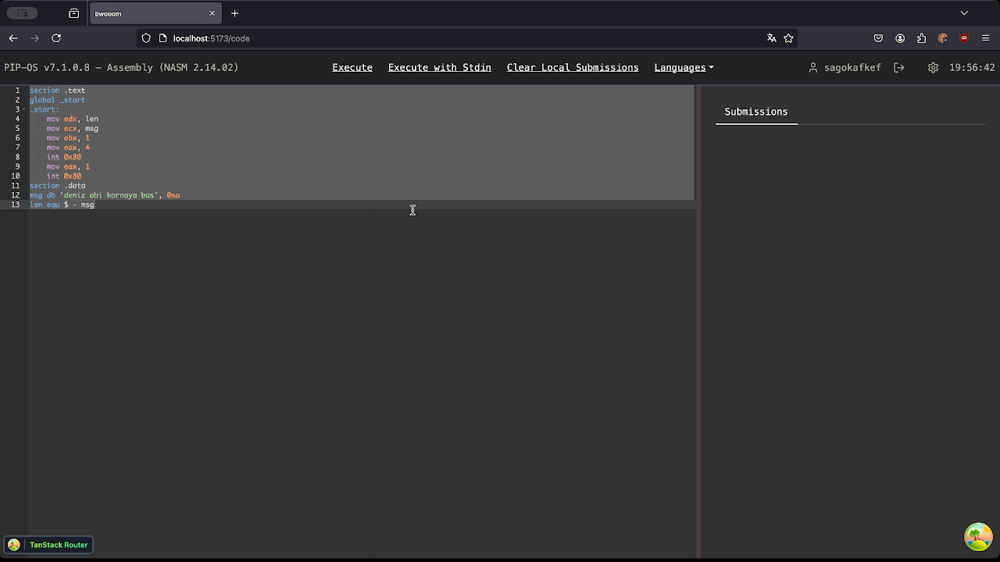
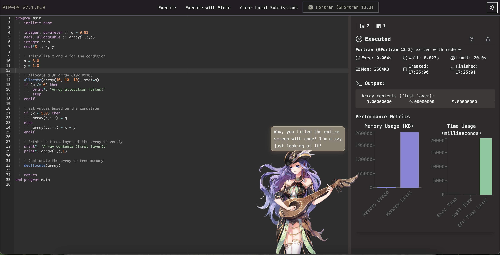
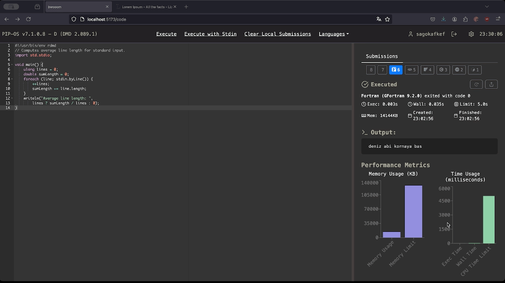
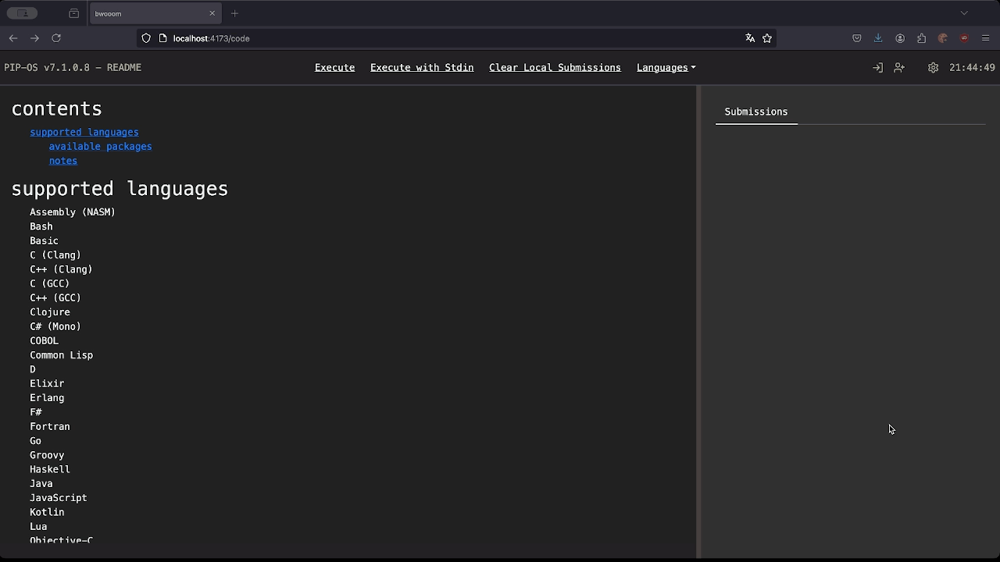

# code.cansu.dev

- [code.cansu.dev](#codecansudev)
  - [Overview](#overview)
  - [Features](#features)
    - [Autocomplete and Snippets](#autocomplete-and-snippets)
    - [Shareable Code Output](#shareable-code-output)
    - [Reactive Live2D Model](#reactive-live2d-model)
    - [Standard Input (Stdin) Support](#standard-input-stdin-support)
    - [Fast Execution and Loading](#fast-execution-and-loading)
    - [Network Efficiency](#network-efficiency)
    - [Security](#security)
    - [Real-Time Collaboration (WIP)](#real-time-collaboration-wip)
  - [Supported Languages](#supported-languages)
  - [Additional Information](#additional-information)

**Live version (main branch):** [https://code.cansu.dev](https://code.cansu.dev)

**Development version (haul branch, unstable):** [https://haul.code-cansu-dev.pages.dev](https://haul.code-cansu-dev.pages.dev)

## Overview

code.cansu.dev is an online code playground supporting 38 language environments, each equipped with autocompletion, snippets, and syntax highlighting.

> The interface is under active development. The UI shown in screenshots, GIFs, and videos may not reflect the current live version of the project.

## Features

### Autocomplete and Snippets

### Shareable Code Output

### Reactive Live2D Model

### Standard Input (Stdin) Support

### Fast Execution and Loading

### Network Efficiency

From Haskell to NASM, Prolog, and Lua, every language runs within 2 MB of network traffic (3.7 MB including the Live2D model), with all autocompletions and snippets included.

For comparison, with an empty cache, JDoodle consumes 3.05 MB of network traffic just to load COBOL. This project requires approximately 1.6 MB for the initial load of all languages, and switching languages is nearly instantaneous, whereas JDoodle transfers around 6 MB of network traffic just to switch from COBOL to Fortran.

With a cached initial load, the network transfer is only 4 KB, and executions and queries consume only a few kilobytes each.

### Security

As of the latest versions, this project no longer relies on third-party, self-hosted solutions for code execution. Instead, it uses a purpose-built solution based on the Docker Engine API.

Previous versions used a worker–slave architecture in which one or more worker machines processed all submissions, mixing every submission on a single machine. Now, each submission runs in its own container with a dedicated operating system and filesystem, providing a unique and disposable sandboxed environment.

### Real-Time Collaboration (WIP)

A basic version of real-time collaboration is live on the main branch and available at [https://code.cansu.dev](https://code.cansu.dev). It is currently unstable and may contain bugs.

This feature is under heavy development and is not yet feature-complete. Planned work includes, but is not limited to, multiple cursor tracking, chat rooms, and separate code tabs, along with further UI improvements.

## Supported Languages

* [Assembly (NASM 2.16.03)](https://code.cansu.dev/language/redirect/assembly)
* [Bash (5.0.0)](https://code.cansu.dev/language/redirect/bash)
* [C (GCC 7.4.0)](https://code.cansu.dev/language/redirect/c)
* [C++ (GCC 10.2)](https://code.cansu.dev/language/redirect/cpp)
* [Common Lisp (SBCL 2.4.9)](https://code.cansu.dev/language/redirect/lisp)
* [D (DMD 2.109.1)](https://code.cansu.dev/language/redirect/d)
* [Elixir (1.17.3)](https://code.cansu.dev/language/redirect/elixir)
* [Erlang (OTP 27.1.2)](https://code.cansu.dev/language/redirect/erlang)
* [Fortran (GFortran 13.3)](https://code.cansu.dev/language/redirect/fortran)
* [Go (1.23.2)](https://code.cansu.dev/language/redirect/go)
* [Haskell (7.8.4)](https://code.cansu.dev/language/redirect/haskell)
* [Java (OpenJDK 23)](https://code.cansu.dev/language/redirect/java)
* [JavaScript (Bun 1.1.33)](https://code.cansu.dev/language/redirect/javascript)
* [Lua (5.4.7)](https://code.cansu.dev/language/redirect/lua)
* [OCaml (5.2.0)](https://code.cansu.dev/language/redirect/ocaml)
* [Octave (9.2.0)](https://code.cansu.dev/language/redirect/octave)
* [Pascal (FPC 3.2.2)](https://code.cansu.dev/language/redirect/pascal)
* [PHP (8.3.13)](https://code.cansu.dev/language/redirect/php)
* [Prolog (GNU Prolog 1.4.5)](https://code.cansu.dev/language/redirect/prolog)
* [Python (2.7.17)](https://code.cansu.dev/language/redirect/python)
* [Ruby (2.7.0)](https://code.cansu.dev/language/redirect/ruby)
* [Rust (1.82.0)](https://code.cansu.dev/language/redirect/rust)
* [TypeScript (Bun 1.1.33)](https://code.cansu.dev/language/redirect/typescript)
* [COBOL (GnuCOBOL 3.1.2)](https://code.cansu.dev/language/redirect/cobol)
* [Kotlin (2.0.21)](https://code.cansu.dev/language/redirect/kotlin)
* [Objective-C (Clang 7.0.1)](https://code.cansu.dev/language/redirect/objectivec)
* [R (4.4.1)](https://code.cansu.dev/language/redirect/r)
* [Scala (3.5.2)](https://code.cansu.dev/language/redirect/scala)
* [SQL (SQLite 3.46.1.1)](https://code.cansu.dev/language/redirect/sql)
* [Swift (6.0.1)](https://code.cansu.dev/language/redirect/swift)
* [Visual Basic .NET (vbnc 0.0.0.5943)](https://code.cansu.dev/language/redirect/vbnc)
* [Perl (5.40.0)](https://code.cansu.dev/language/redirect/perl)
* [Clojure (1.11.2)](https://code.cansu.dev/language/redirect/clojure)
* [Nim (2.2.0)](https://code.cansu.dev/language/redirect/nim)
* [Groovy (4.0.23)](https://code.cansu.dev/language/redirect/groovy)

## Additional Information

**Contact:** [hello@cansu.dev](mailto:hello@cansu.dev)

**Changelog:** available in `public/readme.md` and viewable on the website.

**Palette:** `#211e20`, `#504945`, `#2c2a2a`, `#3c3836` — for text, either `#e9efec` or `#9ca3af`.
